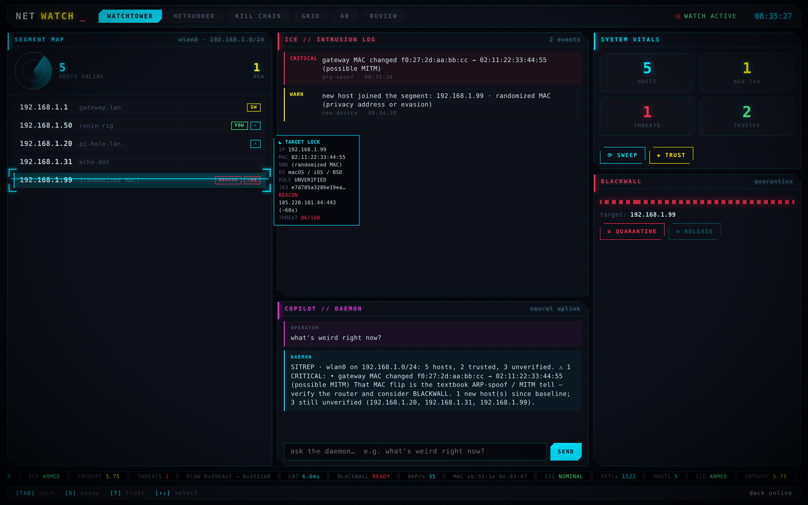
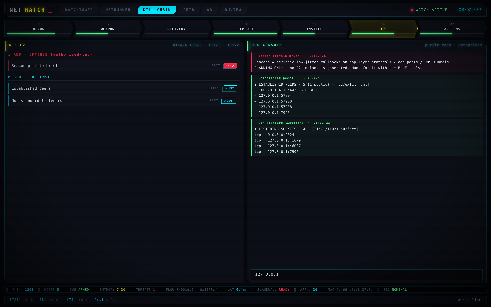
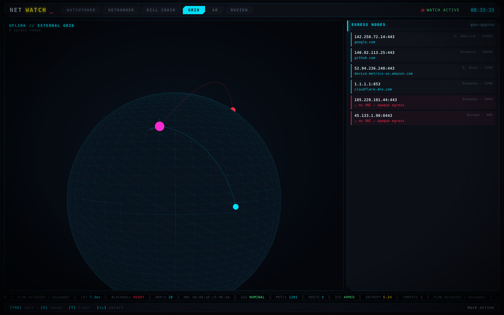

# NetWatch

> A cyberpunk network console. Futuristic, experimental, AI-native security tooling —
> inspired by NetWatch and the netrunners of Cyberpunk 2077.

`netwatch` is the **R&D sandbox** counterpart to a grounded, enterprise suite
(*Ronin Suite*). Where that suite is modern-day production security, NetWatch
is where the bleeding-edge gets prototyped: AI-driven detection, agentic
response, and hardware/RF/3D fusion — behind a sleek Cyberpunk-2077-style HUD.

One binary, multiple **decks**:

| Deck | Stance | Status |
|------|--------|--------|
| **Watchtower** | Defensive — watch the segment, guard the wall | ✅ working (GUI + TUI) |
| **Breach** | Offensive — authorized recon & lab testing | 🟡 recon seed (scope-locked) |
| **Kill Chain** | Purple team — Lockheed-Martin kill chain | ✅ working |
| **ATT&CK** | Purple team — MITRE ATT&CK tactics (TA0043→TA0040) | ✅ working |
| **SONAR** | Spatial awareness — Wi-Fi CSI presence sensing from ESP32-S3 nodes | 🟡 engine + simulator working; firmware untested on hardware |

> **Scope & ethics.** NetWatch is for **defense, your own networks, lab
> environments, CTFs, and engagements you are authorized to perform**. The
> offensive deck is scope-locked to private/lab address space and refuses public
> targets. Don't point it at things you don't own or have permission to test.





A screenshot of every deck and kill-chain stage is in [`docs/tour/`](docs/tour).

---

## Quick start (Linux)

Requires Go ≥ 1.24. The capture layer is **pure-Go AF_PACKET — no libpcap, no
cgo** — so it builds to a single static binary; the GUI is embedded inside it.

```bash
make build
```

```bash
# Preview the console with sample data — no privileges needed:
./bin/netwatch gui --demo
```

```bash
# Live watch (needs raw sockets + nftables). Grant caps instead of running as root:
sudo setcap cap_net_raw,cap_net_admin+eip ./bin/netwatch
./bin/netwatch gui
```

The GUI serves on `http://127.0.0.1:7979` and auto-opens your browser.
`cap_net_raw` covers capture/injection; `cap_net_admin` powers BLACKWALL (nftables).

### Commands

```
netwatch gui     # Cyberpunk web console — primary UI
netwatch watch    # lightweight terminal deck (TUI fallback)
netwatch sweep    # one-shot device discovery, printed to the terminal
```

`gui` flags: `--demo`, `--addr 127.0.0.1:7979`, `--auto 20s` (sweep interval,
`0` disables), `--no-open`.

---

## The Watchtower deck (defensive)

Defensive situational awareness for your LAN, rendered as a neon command deck.

- **SEGMENT MAP / SWEEP** — active ARP discovery of every host, with MAC-vendor
  (OUI) fingerprinting, reverse-DNS, and `you` / `gateway` / trusted tagging.
- **ICE** (Intrusion Countermeasures) — detection engine. Flags **new hosts
  joining** and **gateway-MAC changes** (classic ARP-spoof / MITM signal).
  Passive packet-level detectors (live ARP-spoof, port-scan, rogue DHCP) next.
- **COPILOT** — an AI daemon you can ask *"what's weird right now?"*. Today it
  reasons over live state locally; the `copilot.Copilot` interface lets an LLM
  backend (local model or API) drop in behind the same call.
- **BLACKWALL** — one-click **quarantine** of a selected host via nftables
  (behind an explicit confirm). Release just as easily. Gateway and self are
  protected from accidental lockout.
- **VITALS** — live counts: hosts, new, threats, trusted.

## The Breach deck (recon seed)

Authorized, lab-scoped recon. **PROBE** runs a concurrent TCP-connect scan of a
target across common + IoT ports — and **refuses any non-private address**.

## The ATT&CK deck (purple team)

The same structure as Kill Chain, over the **MITRE ATT&CK** taxonomy: the 14
Enterprise tactics (Reconnaissance → Impact) as a two-row matrix, each with
red (authorized/lab) + blue (detection/audit) actions mapped to ATT&CK technique
IDs and the shared OPS console. Red stays assessment + safe test artifacts +
planning briefs — no weaponization.

## The Kill Chain deck (purple team)

The whole Lockheed-Martin kill chain as an interactive, MITRE ATT&CK-mapped
console — RECON → WEAPONIZATION → DELIVERY → EXPLOITATION → INSTALLATION → C2 →
ACTIONS ON OBJECTIVES. Each stage pairs **RED** (authorized/lab offense) with
**BLUE** (live defense), and an OPS CONSOLE streams results.

The red side is deliberately **assessment + safe test artifacts** (scope-locked
scanning, the benign EICAR string for AV/EDR validation, planning briefs) — *not*
weaponized exploit/C2/malware generators. The blue side does the real work, with
read-only host introspection:

- **Listening-socket audit** — your C2/backdoor surface (`/proc/net/tcp`, or `ss`).
- **Persistence audit** — systemd units, cron, shell rc, autostart, rc.local (T1543/T1547/T1053).
- **Established-peer hunt** — live outbound/inbound TCP peers, **public egress flagged** (C2/exfil, T1041/T1048).
- **EICAR validation** — confirm your scanner actually fires.

## Kiroshi HUD

The optic layer: a boot/uplink sequence, **scramble-decode** text reveals, a live
**telemetry ticker**, a **target-lock reticle** that snaps onto the selected host
with OS / JA3 / beacon / threat-score readout, plus scanlines, CRT flicker and glitch.

The skin (`skin2077.css`) follows the game's scanner view: red rule-lines and a
scan ring framing a green core, navy/cyan panels, a segmented **SEGMENT
INTEGRITY** bar (one block per host, red-outlined when at risk), scanner-style
host rows with a threat cost, and a tabbed **DATA | BLACKWALL** target panel with
trust/exposure glyphs. A **neural-link** layer adds a point-cloud brain that
fires and glitches while the Copilot is parsing, an EEG-style link trace, film
grain, and a glitch cut when you switch decks. UI type is Rajdhani (SIL OFL,
vendored under `assets/vendor/fonts`).

## Passive intelligence engine

Continuous AF_PACKET capture feeds a flow table and a bank of analyzers — all
observation-only, all unit-tested:

- **Passive OS fingerprinting** — classify a host's OS from its TCP SYN (TTL /
  window / MSS), no probing.
- **JA3 TLS fingerprinting** — hash the ClientHello + extract SNI to identify
  clients/tools inside TLS.
- **DGA & DNS-tunnel detection** — entropy + character-class scoring of query
  names; long-label / TXT exfil heuristics.
- **Beaconing detection** — coefficient-of-variation on contact intervals flags
  regular C2-style callbacks.
- **Behavioral anomaly model** — online per-device/per-feature z-score baselines
  (bytes/s, distinct dsts/ports, flow count) score hosts acting unlike
  themselves. Explainable, and upgradeable to an isolation forest behind the
  same API.

Results surface on every device (OS / JA3 / anomaly / beacon chips + reticle).

## GRID — external-connection globe

A live 3D globe (three.js, vendored for offline use) of everything your host is
talking to: arcs from you to each public peer, **red for opaque no-SNI egress**,
cyan for known. The side list geo-locates each node (offline/approximate; a real
MaxMind DB can be slotted in).

## AR — Kiroshi optic overlay

A WebXR/camera deck: point your device at the room and see **floating tags on
each host** — IP, passively-fingerprinted OS, threat score, beacon target —
drawn over the live camera feed. Camera stays on-device. Falls back to a
synthetic overlay where WebXR/camera isn't available.

## SONAR — presence sensing

ESP32-S3 nodes report Wi-Fi **Channel State Information**; a body moving through
the path between the access point and a node disturbs the subcarrier
amplitudes. The engine measures that turbulence against a calm baseline and
shows which link is disturbed on a top-down map you arrange to match your room.
It is zone-level sensing, not coordinates.

```bash
netwatch gui --sonar-udp 0.0.0.0:5566     # listen for nodes on your LAN (off by default)
```

```bash
netwatch sonar-sim                        # simulated nodes, to try it before hardware
```

**ARM** it when you want movement to raise an ICE alert; disarmed, it only
draws. Firmware lives in `firmware/esp32s3-csi` and has **not yet been compiled
or run on a board**.

## Copilot — free, local model

The Copilot uses a model served by [Ollama](https://ollama.com) on your own
machine when one is running, and the built-in rules otherwise. No API key, no
token cost, and nothing about your network leaves the host.

```bash
ollama pull llama3.2
```

Start `netwatch gui` afterwards and the Copilot panel shows
`local model · llama3.2`. `NETWATCH_LLM_MODEL` picks a model, `NETWATCH_LLM_URL`
points at another Ollama host, `NETWATCH_LLM=off` forces the built-in rules.

## Commands, voice, spatial audio, time scrubber

- **Commands** — the Copilot box is also a command line: `sweep`,
  `select gateway`, `select 99`, `trust`, `quarantine pi-hole` (asks you to
  `confirm`), `release`, `switch to sonar`, `rewind 10 minutes`, `go live`,
  `arm sonar`, `audio on`. Anything else goes to the Copilot as a question.
- **Voice** — the VOICE button (or `V`) speaks the same commands and reads the
  reply back. It uses the browser's speech recognition; in Chrome that sends
  audio to Google, so type instead if you want everything to stay local.
- **Spatial audio** — AUDIO ON plays each new alert from a direction: SONAR
  nodes from where you placed them on the map, hosts from a fixed bearing per
  address. Use headphones.
- **Time scrubber** — drag the bar above the ticker to replay the console's
  recent past (ticks mark alerts; red is critical). Controls lock while
  replaying; LIVE returns to the present. History is kept in memory only.

## Architecture

```
main.go                      entrypoint
internal/
  model/      core types (Device, Alert, Severity)
  netif/      interface / subnet / gateway discovery (parses /proc/net/route)
  capture/    AF_PACKET raw socket — pure Go (capture_linux.go), stub elsewhere
  oui/        MAC-prefix -> vendor (built-in table + optional IEEE CSV load)
  sweep/      SWEEP: ARP request injection + reply collection
  ice/        ICE engine: sweep-diff detectors (ARP-spoof, new-device)
  blackwall/  nftables quarantine (atomic rebuild of one dedicated table)
  copilot/    AI daemon — heuristic now, LLM-pluggable via the Copilot interface
  offensive/  Breach recon — scope-locked TCP-connect scan
  audit/      blue-team host introspection (listeners, persistence, peers, EICAR)
  passive/    live capture + flow table + analyzers (OS fp, JA3, DNS/DGA, beacon)
  anomaly/    online behavioral-anomaly model (per-device z-score baselines)
  geo/        offline IP -> globe placement (real GeoIP pluggable)
  sonar/      Wi-Fi CSI presence engine (turbulence vs baseline) + simulator
  server/     HTTP server: serves the GUI + SSE live stream + action endpoints
  webui/      embedded Cyberpunk web console (assets/ baked in with go:embed)
  tui/        terminal deck (Bubble Tea) — fallback
  theme/      cyberpunk palette + banner
  cli/        cobra command tree (netwatch gui | watch | sweep)
```

The capture + model + ICE engine is deck-agnostic: the GUI, the TUI, and the
offensive deck all consume the same core. The front-end (plain HTML/CSS/JS, no
build step) can also be dropped into a native Wails window later for a packaged
desktop app.

---

## Roadmap

**NetWatch — deepen the defense**
- [x] Cyberpunk GUI shell + live SSE stream.
- [x] BLACKWALL nftables quarantine.
- [x] Copilot (local heuristic) + pluggable LLM interface.
- [ ] Passive live capture: continuous flow table (top talkers, per-host bandwidth).
- [ ] Live ICE detectors: real-time ARP-spoof, port-scan-against-us, rogue DHCP, SSDP/mDNS snooping.
- [ ] Persistent asset DB (pure-Go SQLite): trusted/unknown, first/last seen, nicknames.
- [ ] GeoIP + reputation enrichment; auto-pcap on alert; desktop notifications.

**AI-native layer**
- [x] Copilot Q&A over live state.
- [ ] LLM backend (local model / API) behind the Copilot interface.
- [ ] Agentic response: reason about a confirmed threat → propose/execute BLACKWALL (human-in-the-loop).

**Breach deck — offensive (authorized)**
- [x] Scope-locked TCP-connect port/service scan.
- [ ] CIDR ranges, service banners, OS hints.
- [ ] Traffic masking / VPN (WireGuard) integration.

**SONAR — spatial**
- [ ] ESP32-S3 sensor mesh ingestion (Wi-Fi/BLE/UWB) → live 3D map.

---

## Status

The NetWatch deck is working end-to-end: SWEEP, sweep-diff ICE, the live
Cyberpunk GUI (SSE), BLACKWALL quarantine, the Copilot daemon, and a
scope-locked recon probe. Everything builds to one static, cgo-free binary.
