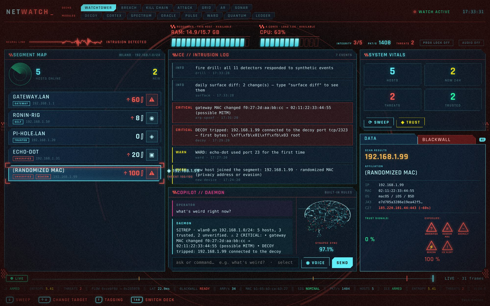
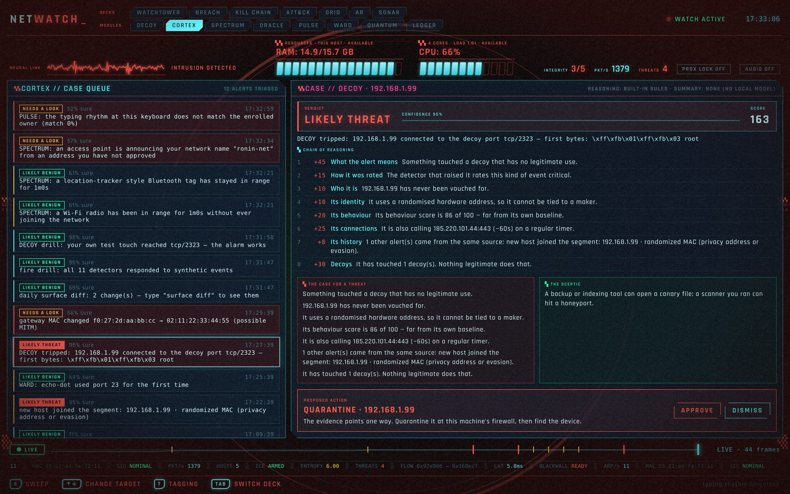

# NetWatch

> An experimental network and spatial-sensing console with a Cyberpunk 2077
> scanner HUD. A testing ground for security ideas that are still unusual.

NetWatch is the R&D counterpart to a grounded, enterprise suite (*Ronin
Suite*). It watches your local network, senses movement in your space from
Wi-Fi signals, and lets you replay both.



> **Scope.** NetWatch is for your own networks and spaces, lab environments,
> and work you are authorised to do. Anything that touches other machines is
> limited to private address space.

## Documentation

| | |
|---|---|
| **[Guide](docs/GUIDE.md)** | Install, run, every deck, commands, hardware, files and privacy. |
| **[Experimental feature registry](docs/EXPERIMENTAL.md)** | The growing list of every experimental feature, how far each has been proven, and ideas not built yet. |
| **[Architecture](docs/ARCHITECTURE.md)** | Packages, HTTP API, background loops, how to add a feature. |

## Quick start (Linux)

Requires Go 1.24+. Builds to one static binary with the console embedded.

```bash
make build
```

```bash
./bin/netwatch gui --demo
```

That runs with sample data and touches nothing. To watch your real network:

```bash
sudo setcap cap_net_raw,cap_net_admin+eip ./bin/netwatch
```

```bash
./bin/netwatch gui
```

## Decks

| Deck | What it is |
|---|---|
| **Watchtower** | Hosts on your network, intrusion alerts, a Copilot you can question or command, and BLACKWALL to quarantine a host. |
| **Breach** | A connect scan that refuses any public address. |
| **Kill Chain** / **ATT&CK** | Purple-team consoles over the Lockheed-Martin stages and the MITRE tactics, with audits you can run on this machine. |
| **GRID** | A globe of the public addresses your network talks to, with the local program behind each. |
| **AR** | Host tags over your camera feed. |
| **SONAR** | Presence sensing from ESP32-S3 Wi-Fi nodes: a 3D room view, tripwires, located hosts, breathing, and braindance recordings you can replay. |

The second row of tabs holds the modules:

| Module | What it is |
|---|---|
| **DECOY** | Honeyports, canary files and canary host names: things with no legitimate use, so any touch is an alarm. |
| **CORTEX** | Investigates an alert: gathers the evidence, argues for and against a threat, and proposes one action that waits for your approval. |
| **SPECTRUM** | Every Wi-Fi and Bluetooth radio the sensor nodes hear; flags strangers that linger, tracker tags, look-alike access points and disconnect floods. |
| **ORACLE** | What each host really talks to, what a quarantine would stop, and a what-if box for testing a rule against observed traffic. |
| **PULSE** | Learns your typing rhythm (timing only, never the keys) and alerts when someone else is at the keyboard. |
| **WARD** | Learns each device's normal destinations, ports and hours, then flags steps outside them. |
| **QUANTUM** | Inventories the TLS and SSH on your own network and shows what is exposed to record-now, decrypt-later. |
| **LEDGER** | A hash-chained record of every alert and action, with a verify button and an incident report. |




## How proven is it?

Much of NetWatch runs ahead of what has been tested on real hardware. The
[registry](docs/EXPERIMENTAL.md) marks every feature as proven on real data,
tested only on simulated data, or written but never run. In short:

- The network console, firewall quarantine, host audits, process lineage and
  the interface have run on real data. So have the honeyports, canary files
  and the LEDGER's hash chain, on this machine only.
- Everything on SONAR has only seen the built-in simulator, and the ESP32-S3
  firmware has not been compiled or flashed yet.
- The passive traffic analyzers, the local-model Copilot, voice, spatial audio,
  USB watch and the proximity lock are tested with synthetic input only.
- CORTEX, SPECTRUM, ORACLE, PULSE, WARD and QUANTUM have only seen sample or
  scripted input: PULSE has never been tried on a human typist, and nothing
  yet sends SPECTRUM any Bluetooth data.

## Privacy

Nothing leaves your machine unless you turn on voice in Chrome (speech goes to
Google) or point the Copilot at an Ollama host that is not yours. SONAR
recordings and the respiration log describe when people moved and breathed in
your space; they are stored locally, and the [guide](docs/GUIDE.md#files-and-privacy)
says where. PULSE keeps four numbers describing your typing rhythm and never
records which keys you press.
