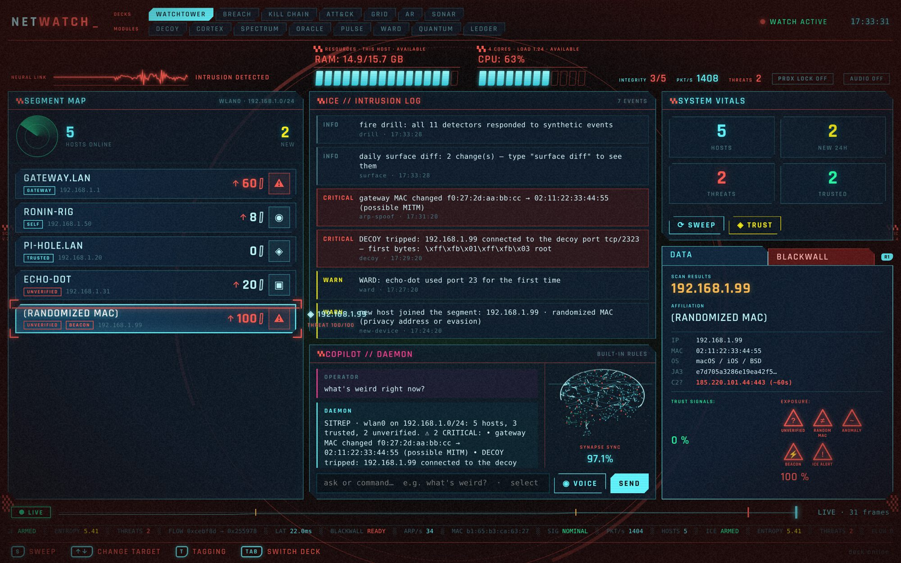
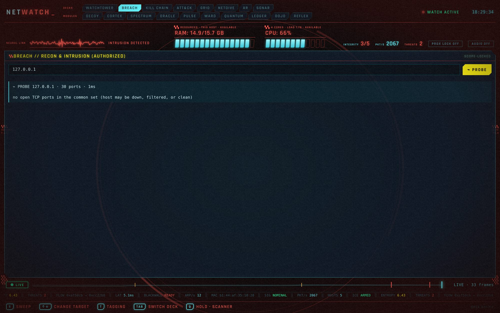
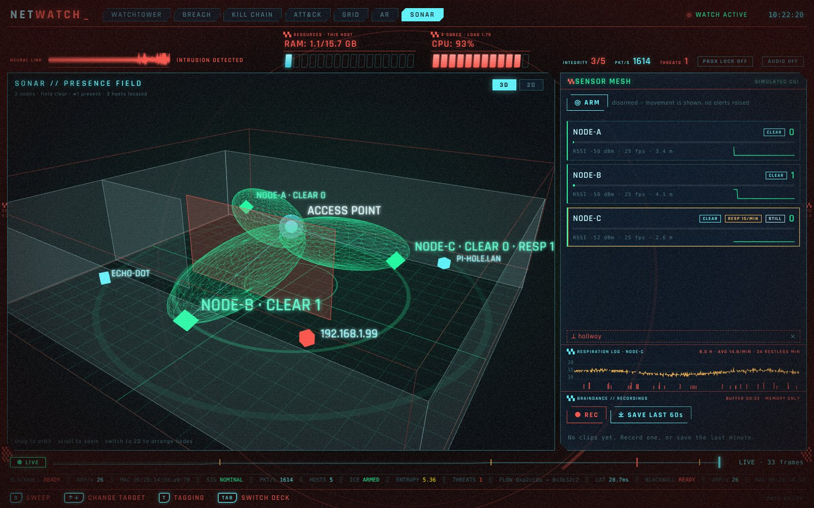
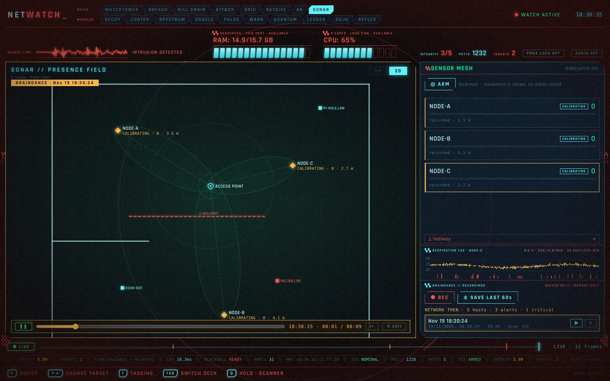

# NetWatch guide

How to run NetWatch and use each part of it. For how far each feature has been
proven, see the [experimental feature registry](EXPERIMENTAL.md). For how the
code is laid out, see [architecture](ARCHITECTURE.md).

NetWatch is for your own networks and spaces, lab environments, and work you
are authorised to do.

## Contents

- [Install and run](#install-and-run)
- [The console](#the-console)
- [Decks](#decks): [Watchtower](#watchtower) · [Breach](#breach) · [Kill Chain and ATT&CK](#kill-chain-and-attck) · [GRID](#grid) · [AR](#ar) · [SONAR](#sonar)
- [Commands and voice](#commands-and-voice)
- [The Copilot and local models](#the-copilot-and-local-models)
- [Host features](#host-features)
- [ESP32-S3 hardware](#esp32-s3-hardware)
- [Files and privacy](#files-and-privacy)
- [Troubleshooting](#troubleshooting)

---

## Install and run

Requires Linux and Go 1.24 or newer. NetWatch builds to one static binary with
the web console embedded; it needs no libpcap.

```bash
make build
```

**Try it with sample data** (no privileges, nothing touches your network):

```bash
./bin/netwatch gui --demo
```

**Watch your real network.** Raw sockets and the firewall need capabilities;
grant them to the binary instead of running as root:

```bash
sudo setcap cap_net_raw,cap_net_admin+eip ./bin/netwatch
```

```bash
./bin/netwatch gui
```

The console opens at `http://127.0.0.1:7979`.

### Subcommands

| Command | What it does |
|---|---|
| `netwatch gui` | The web console. |
| `netwatch watch` | A lighter terminal view of hosts and alerts. |
| `netwatch sweep` | One-off host discovery printed to the terminal. |
| `netwatch sonar-sim` | Sends simulated sensor frames to a running console, to try SONAR without hardware. |

### `gui` flags

| Flag | Default | Meaning |
|---|---|---|
| `--demo` | off | Sample data; no capture, no firewall changes, the screen is never locked. |
| `--addr` | `127.0.0.1:7979` | Where the console listens. |
| `--auto` | `20s` | How often to sweep the network (`0` disables). |
| `--no-open` | off | Do not open the browser. |
| `--sonar-udp` | off | Accept sensor frames on this UDP address, e.g. `0.0.0.0:5566`. |
| `--data-dir` | `~/.local/share/netwatch` | Where clips, the room layout, the respiration log and surface snapshots are kept. Empty keeps everything in memory. |

### Environment

| Variable | Meaning |
|---|---|
| `NETWATCH_LLM` | `off` forces the Copilot's built-in rules. |
| `NETWATCH_LLM_URL` | Ollama address (default `http://127.0.0.1:11434`). |
| `NETWATCH_LLM_MODEL` | Model name (default: the first one installed). |

---

## The console



- **Top bar** — deck tabs, watch status, clock.
- **Strip below it** — a link trace that turns red on intrusion; **RAM** and
  **CPU** gauges showing what this machine has left (full when idle, draining
  as it is used, red when under 15% remains); host integrity, packets per
  second and threat count; **PROX LOCK** and **AUDIO** switches.
- **Time scrubber** (above the ticker) — drag back to replay the console's
  recent state. Ticks mark alerts; red is critical. Controls lock while you are
  in the past. **LIVE** returns to now. History is kept in memory only.
- **Footer** — key hints: `S` sweep, `↑↓` change target, `T` trust, `V` voice,
  `Tab` next deck.

---

## Decks

### Watchtower

The defensive view of your local network.

- **Segment map** — every host found by sweeping. Each row shows a name, a
  status badge and a threat number. Click a row to lock on.
- **ICE intrusion log** — alerts: new hosts, a gateway that changed MAC
  address, suspicious DNS, beaconing, anomalies, USB events, tripwires.
- **Copilot** — ask a question or type a command (see below).
- **DATA tab** — what is known about the selected host: vendor, passively
  guessed OS, TLS fingerprint, beacon target, and trust and exposure signals.
- **BLACKWALL tab** — **QUARANTINE** blocks the selected host at this
  machine's firewall; **RELEASE** undoes it. Your own machine and the gateway
  cannot be quarantined.
- **Presence key** (BLACKWALL tab) — pick a device, such as your phone, as the
  key. While it is off the network, trust and quarantine are refused. It
  recognises the device by MAC address, so treat it as a convenience lock.

### Breach



A connect scan of one address across common and IoT ports. It refuses anything
outside private address space.

### Kill Chain and ATT&CK


Two views of the same idea: the seven Lockheed-Martin kill-chain stages, and
the fourteen MITRE ATT&CK tactics. Pick a stage; each lists **red** actions
(authorised assessment, safe test artifacts, planning briefs) and **blue**
actions (audits and hunts on this machine). Results appear in the ops console.

Blue actions you can run: listening sockets, start-up entries, established
connections, process lineage, surface diff, detector fire drill.

### GRID


A globe of the public addresses your network talks to. Connections with no
server name are drawn red. The list names the local program behind each
connection where it can.

Positions on the globe are **not real geography** yet; each address is placed
consistently but arbitrarily until a GeoIP database is added.

### AR

Host tags drawn over your camera feed. **ENGAGE OPTIC** asks for the camera;
the feed stays on your device. Tags are not anchored to where devices really
are.

### SONAR



Presence sensing from Wi-Fi signals. Each ESP32-S3 node senses the path between
itself and your access point; someone moving through that path disturbs the
signal. See [ESP32-S3 hardware](#esp32-s3-hardware) to connect nodes, or run
`netwatch sonar-sim`. The demo runs three simulated nodes.

**Views.** 3D by default (drag to orbit, scroll to zoom); **2D** for arranging.
Without WebGL the deck opens in 2D.


**Arranging the room (2D).**
- **MOVE** — drag the access point and nodes to where they really are. A node
  that reports a measured range stays at that distance; you set the direction.
- **DRAW WALL** — drag to sketch walls. **UNDO WALL** removes the last one.
- **DRAW TRIPWIRE** — drag a line and name it. Remove one from the list on the
  right.

**Reading it.**
- A link's zone turns red when it is disturbed. The marker and trail show the
  estimated position of the movement.
- Each node shows an activity (`still`, `moving`, `walking`, `fall?`) and, on a
  still link, a breathing rate (`RESP n/min`).
- The header line gives a rough head count and how many hosts are located.
- Square markers are network hosts placed from signal strength; red means the
  host is a threat, hollow means fewer than three nodes can hear it.

**ARM.** Disarmed, SONAR only draws. Armed, movement raises an alert, a
tripwire crossing raises a critical alert, a possible fall raises a warning,
and a clip is saved around each movement.

**Respiration log.** Click a node to chart its last 24 hours of breathing rate
and movement.

**Braindance** — recordings of the presence field.



- **REC** starts and stops a clip. **SAVE LAST 60s** keeps what just happened.
- **▶** replays a clip in the room view: play/pause, seek, 0.5–4× speed, **EXIT**.
- While a clip plays, the panel shows the network's host and alert counts from
  that moment, if the console still has them.

---

## Commands and voice

The Copilot box is also a command line. Anything it does not recognise is
passed to the Copilot as a question. **VOICE** (or `V`) accepts the same
commands by speech and reads the reply aloud.

| Say or type | Effect |
|---|---|
| `sweep` | Sweep the network now. |
| `select gateway` · `select pi-hole` · `select 99` | Lock on to a host by role, name or last octet. |
| `trust` · `untrust` (optionally a host) | Mark a host trusted or unverified. |
| `quarantine <host>` then `confirm` | Block a host at the firewall. `cancel` aborts. |
| `release <host>` | Lift a quarantine. |
| `switch to sonar` (or any deck) | Change deck. |
| `rewind 10 minutes` · `go live` | Move the time scrubber. |
| `arm sonar` · `disarm sonar` | Arm or disarm SONAR. |
| `record` · `stop recording` · `save clip` | Braindance recording. |
| `play last clip` · `exit replay` | Braindance replay. |
| `how many people` | SONAR head count. |
| `sleep report` | Summary of the respiration log. |
| `set key <host>` · `clear key` | Presence key. |
| `what changed` | Daily surface diff. |
| `fire drill` | Run the detector fire drill. |
| `usb` | List USB devices. |
| `lock` | Lock the screen. |
| `proximity lock on` · `off` | Ultrasonic proximity lock. |
| `audio on` · `audio off` | Spatial audio alerts. |

Voice uses the browser's speech recognition. In Chrome that sends audio to
Google; type the commands if you want everything to stay on your machine.

---

## The Copilot and local models

The Copilot answers questions about the current state of your network. It uses
a model served by [Ollama](https://ollama.com) on your own machine when one is
running, and built-in rules otherwise. There is no API key or token cost, and
nothing leaves the host.

```bash
ollama pull llama3.2
```

Start the console afterwards; the Copilot panel shows which backend is
answering. If your machine is short on memory, try a smaller model such as
`llama3.2:1b` and set `NETWATCH_LLM_MODEL`. You can also run Ollama on another
machine on your LAN and point `NETWATCH_LLM_URL` at it.

Names and text observed on the network are passed to the model as data and it
is told not to follow instructions found in them.

---

## Host features

These watch the machine NetWatch runs on.

- **Spatial audio** — **AUDIO ON** plays each new alert from a direction. Use
  headphones.
- **Proximity lock** — **PROX LOCK** plays a quiet 19 kHz tone and listens for
  movement near the laptop. After a minute of none it warns for ten seconds,
  then locks the screen. It needs the microphone. It may not work on speakers
  that cannot reach 19 kHz, and someone sitting perfectly still looks the same
  as an empty chair.
- **USB watch** — a newly attached device raises an alert; keyboards are called
  out. If NetWatch can read `/dev/input`, a keyboard that types faster than a
  person raises a critical alert.
- **Daily surface diff** — compares listening ports, start-up entries, hosts
  and USB devices with the previous day. Runs daily; ask with `what changed`.
- **Detector fire drill** — stages harmless synthetic events against each
  detector at start-up and daily, and raises a critical alert if one stays
  silent. Ask with `fire drill`.
- **Process lineage** — which program owns each connection. Shown on GRID and
  in the Kill Chain and ATT&CK ops consoles.

---

## ESP32-S3 hardware

The node firmware is in `firmware/esp32s3-csi`. **It has not yet been compiled
or run on a board**; expect small fixes on first build.

1. Install ESP-IDF v5 using Espressif's guide for Linux.
2. In `main/csi_node.c`, set your Wi-Fi name and password, a unique
   `NODE_NAME` per board, and the IP address of the machine running NetWatch.
3. Flash each board:

   ```bash
   cd firmware/esp32s3-csi && idf.py set-target esp32s3
   ```

   ```bash
   idf.py build flash monitor
   ```

4. Start the console listening on your LAN:

   ```bash
   ./bin/netwatch gui --sonar-udp 0.0.0.0:5566
   ```

5. Open SONAR, keep the room still for about five seconds while nodes
   calibrate, then arrange them in the 2D view.

Things to know:

- The ESP32-S3 only joins 2.4 GHz networks.
- If you run a firewall, allow incoming UDP on port 5566.
- Each node senses the line between itself and the router, so place nodes where
  those lines cross the spaces you care about. Three or four around a room give
  the position estimates something to work with.
- Ranging only works if your router supports 802.11mc (FTM). The firmware logs
  whether it does.
- If the laptop's IP address changes, the boards lose their target. A DHCP
  reservation avoids reflashing.

Each sensor frame is one JSON datagram:

```json
{"node":"node-A","rssi":-51,"amp":[12.0,13.4],"dist_cm":412}
```

and once a second, the devices the node overheard:

```json
{"node":"node-A","seen":[{"mac":"aa:bb:cc:dd:ee:ff","rssi":-52}]}
```

---

## Files and privacy

Everything NetWatch stores is under the data directory
(`~/.local/share/netwatch` unless you pass `--data-dir`):

| Path | Contents |
|---|---|
| `braindance/bd-*.json` | Braindance clips. |
| `room.json` | Node positions, walls and tripwires. |
| `sleep.json` | The respiration log. |
| `surface/surface-YYYY-MM-DD.json` | Daily surface snapshots. |

Nothing is sent off the machine. Two features involve other services if you
turn them on: voice in Chrome (speech goes to Google) and a Copilot pointed at
an Ollama host that is not your own machine.

Braindance clips and the respiration log record when people moved and breathed
in your space. Keep them private, and tell the people you live or work with
that SONAR is running.

---

## Troubleshooting

| Symptom | Likely cause |
|---|---|
| "permission denied opening raw socket" | Run the `setcap` command above, or use `--demo`. |
| Quarantine fails | The binary lacks `cap_net_admin`, or `nft` is not installed. |
| SONAR shows "no nodes reporting" | The console was not started with `--sonar-udp`, a firewall is blocking UDP 5566, or the boards are pointed at the wrong IP. |
| 3D button is disabled | The browser is not providing WebGL; 2D still works. |
| Copilot says "built-in rules" | Ollama is not running, or has no model installed. |
| VOICE button is disabled | The browser has no speech recognition; type commands instead. |
| Trust or quarantine is refused | A presence key is set and that device is off the network. |
| Process names are missing | The connection belongs to another user; run NetWatch as root to see it. |
