# NetWatch guide

How to run NetWatch and use each part of it. For how far each feature has been
proven, see the [experimental feature registry](EXPERIMENTAL.md). For how the
code is laid out, see [architecture](ARCHITECTURE.md).

NetWatch is for your own networks and spaces, lab environments, and work you
are authorised to do.

## Contents

- [Install and run](#install-and-run)
- [The console](#the-console)
- [Decks](#decks): [Watchtower](#watchtower) · [Breach](#breach) · [Kill Chain and ATT&CK](#kill-chain-and-attck) · [GRID](#grid) · [NETDIVE](#netdive) · [AR](#ar) · [SONAR](#sonar)
- [Modules](#modules): [DECOY](#decoy) · [CORTEX](#cortex) · [SPECTRUM](#spectrum) · [ORACLE](#oracle) · [PULSE](#pulse) · [WARD](#ward) · [QUANTUM](#quantum) · [LEDGER](#ledger) · [DOJO](#dojo) · [REFLEX](#reflex) · [Phone companion](#phone-companion)
- [Commands and voice](#commands-and-voice)
- [The Copilot and local models](#the-copilot-and-local-models)
- [Host features](#host-features)
- [ESP32-S3 hardware](#esp32-s3-hardware)
- [Files and privacy](#files-and-privacy)
- [Troubleshooting](#troubleshooting)

---

## Install and run

Requires Linux and Go 1.24 or newer. NetWatch builds to one static binary with
the web console embedded; it needs no libpcap.

```bash
make build
```

**Try it with sample data** (no privileges, nothing touches your network):

```bash
./bin/netwatch gui --demo
```

**Watch your real network.** Raw sockets and the firewall need capabilities;
grant them to the binary instead of running as root:

```bash
sudo setcap cap_net_raw,cap_net_admin+eip ./bin/netwatch
```

```bash
./bin/netwatch gui
```

The console opens at `http://127.0.0.1:7979`.

### Subcommands

| Command | What it does |
|---|---|
| `netwatch gui` | The web console. |
| `netwatch watch` | A lighter terminal view of hosts and alerts. |
| `netwatch sweep` | One-off host discovery printed to the terminal. |
| `netwatch sonar-sim` | Sends simulated sensor frames to a running console, to try SONAR without hardware. |

### `gui` flags

| Flag | Default | Meaning |
|---|---|---|
| `--demo` | off | Sample data; no capture, no firewall changes, no decoys opened or planted, no hosts probed, the screen is never locked. |
| `--addr` | `127.0.0.1:7979` | Where the console listens. |
| `--auto` | `20s` | How often to sweep the network (`0` disables). |
| `--no-open` | off | Do not open the browser. |
| `--sonar-udp` | off | Accept sensor frames on this UDP address, e.g. `0.0.0.0:5566`. Not needed once you have flashed a board from the console: NetWatch then listens on its own. |
| `--companion` | off | Serve the read-only [phone companion](#phone-companion) over HTTPS on this address, e.g. `0.0.0.0:7443`. |
| `--data-dir` | `~/.local/share/netwatch` | Where clips, the room layout, the respiration log, surface snapshots, the ledger and module settings are kept. Empty keeps everything in memory. |

### Environment

| Variable | Meaning |
|---|---|
| `NETWATCH_LLM` | `off` forces the Copilot's built-in rules. |
| `NETWATCH_LLM_URL` | Ollama address (default `http://127.0.0.1:11434`). |
| `NETWATCH_LLM_MODEL` | Model name (default: the first one installed). |

---

## The console


- **Top bar** — two rows of tabs (the decks, then the modules), watch status, clock.
- **Strip below it** — a link trace that turns red on intrusion; **RAM** and
  **CPU** gauges showing what this machine has left (full when idle, draining
  as it is used, red when under 15% remains); host integrity, packets per
  second and threat count; **PROX LOCK** and **AUDIO** switches.
- **Time scrubber** (above the ticker) — drag back to replay the console's
  recent state. Ticks mark alerts; red is critical. Controls lock while you are
  in the past. **LIVE** returns to now. History is kept in memory only.
- **Footer** — key hints: `S` sweep, `↑↓` change target, `T` trust, `V` voice,
  `Tab` next deck, hold `Q` for the scanner.
- **Scanner mode** — hold `Q` anywhere. The console dims and every host fans
  out with its CORTEX verdict; hover one to see what it talks to, how much a
  quarantine would stop, decoys it touched and steps outside its profile, with
  actions underneath (LOCK ON, INVESTIGATE, REACH, TRUST, QUARANTINE — which
  asks you to confirm). Release `Q` to close; click a host to pin the scanner
  open, then `Esc`.

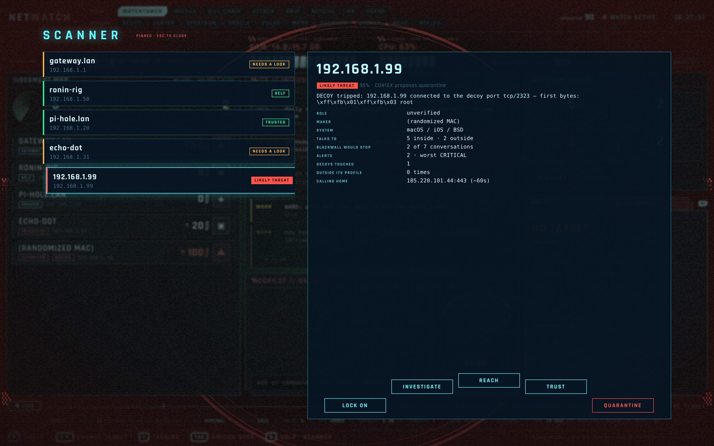

---

## Decks

### Watchtower

The defensive view of your local network.

- **Segment map** — every host found by sweeping. Each row shows a name, a
  status badge and a threat number. Click a row to lock on.
- **ICE intrusion log** — alerts: new hosts, a gateway that changed MAC
  address, suspicious DNS, beaconing, anomalies, USB events, tripwires. Click
  an alert to acknowledge it (it dims). A new-host alert raised while sensor
  nodes are reporting gets a **▶ ROOM** button: the last minute of the room,
  saved as a braindance clip, so you can see whether someone was moving when
  the device appeared.
- **Copilot** — ask a question or type a command (see below).
- **DATA tab** — what is known about the selected host: vendor, passively
  guessed OS, TLS fingerprint, beacon target, and trust and exposure signals.
- **BLACKWALL tab** — **QUARANTINE** blocks the selected host at this
  machine's firewall; **RELEASE** undoes it. Your own machine and the gateway
  cannot be quarantined.
- **Presence key** (BLACKWALL tab) — pick a device, such as your phone, as the
  key. While it is off the network, trust and quarantine are refused. It
  recognises the device by MAC address, so treat it as a convenience lock.

### Breach


A connect scan of one address across common and IoT ports. It refuses anything
outside private address space.

### Kill Chain and ATT&CK

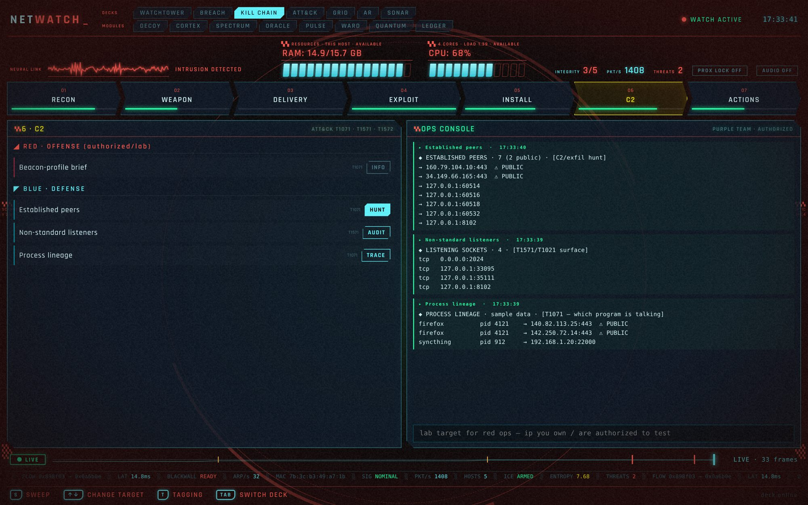

Two views of the same idea: the seven Lockheed-Martin kill-chain stages, and
the fourteen MITRE ATT&CK tactics. Pick a stage; each lists **red** actions
(authorised assessment, safe test artifacts, planning briefs) and **blue**
actions (audits and hunts on this machine). Results appear in the ops console.

Blue actions you can run: listening sockets, start-up entries, established
connections, process lineage, surface diff, detector fire drill.

### GRID

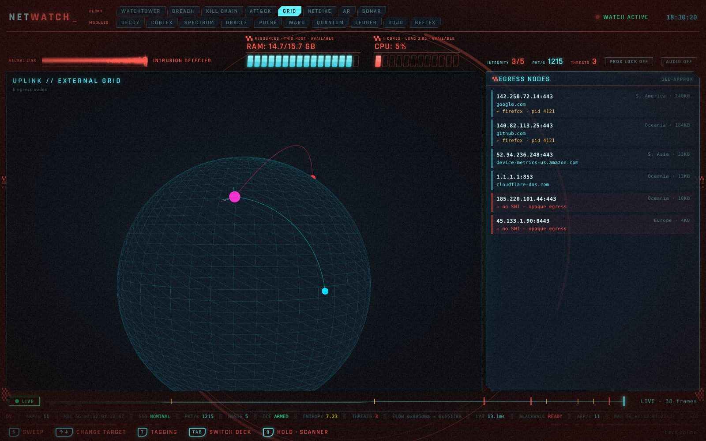

A globe of the public addresses your network talks to. Connections with no
server name are drawn red. The list names the local program behind each
connection where it can.

Positions on the globe are **not real geography** yet; each address is placed
consistently but arbitrarily until a GeoIP database is added.

### NETDIVE

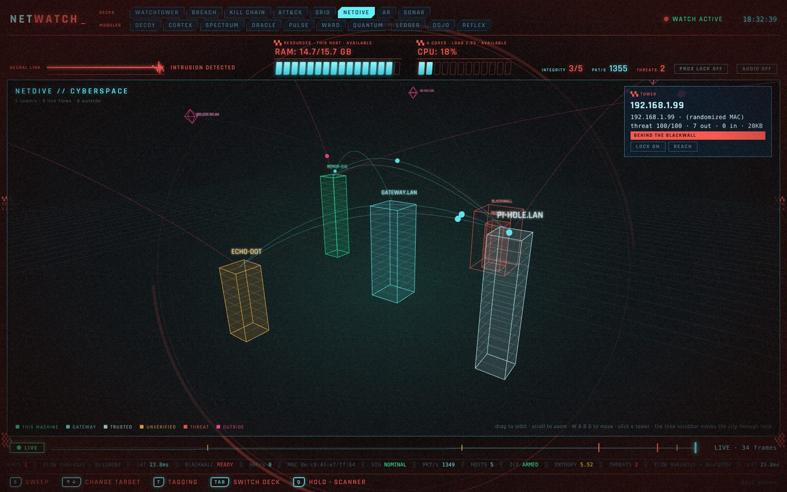

Your network as a city. Each host is a tower — taller the more it has sent and
received — coloured green (this machine), cyan (gateway), pale (trusted), amber
(unverified) or red (a threat). Lights travel along each conversation; the
magenta shapes floating above are destinations outside your network. A
quarantined host stands inside a red wireframe wall, and nothing moves through
it.

- **Drag** to orbit, **scroll** to zoom, **W A S D** to move. Left alone, the
  camera drifts.
- **Click a tower** for its details, **LOCK ON** (Watchtower) or **REACH** (ORACLE).
- Drag the **time scrubber** and the city rebuilds as it was: towers appear and
  vanish. The flows shown are always the ones observed up to now.

NETDIVE needs WebGL.

### AR

Host tags drawn over your camera feed. **ENGAGE OPTIC** asks for the camera;
the feed stays on your device. Tags are not anchored to where devices really
are.

**X-RAY** (button in the AR deck) replaces the host tags with what SONAR senses,
drawn where it is: the presence estimate, links where someone is still and
breathing, the nodes, the access point and located hosts, each with its
distance. Click the small map where you are standing, then drag the view or
the heading slider to look around. It works without a camera.

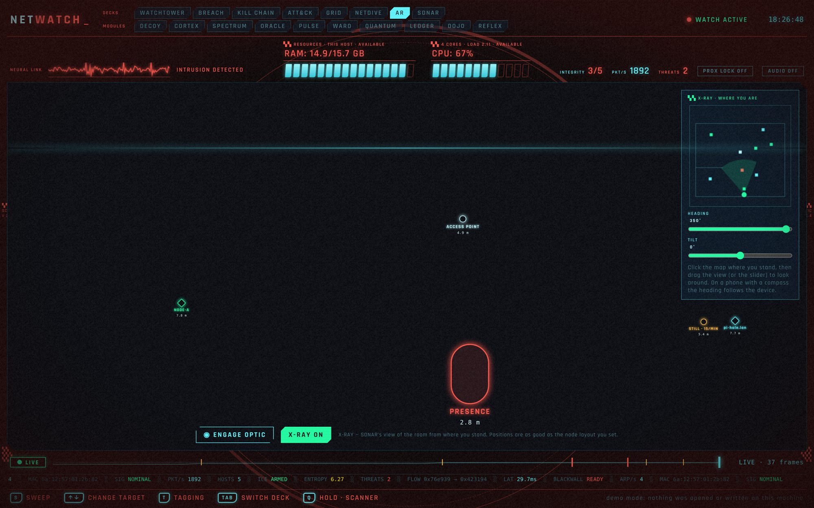

### SONAR


Presence sensing from Wi-Fi signals. Each ESP32-S3 node senses the path between
itself and your access point; someone moving through that path disturbs the
signal. See [ESP32-S3 hardware](#esp32-s3-hardware) to connect nodes, or run
`netwatch sonar-sim`. The demo runs three simulated nodes.

**Views.** 3D by default (drag to orbit, scroll to zoom); **2D** for arranging.
Without WebGL the deck opens in 2D.

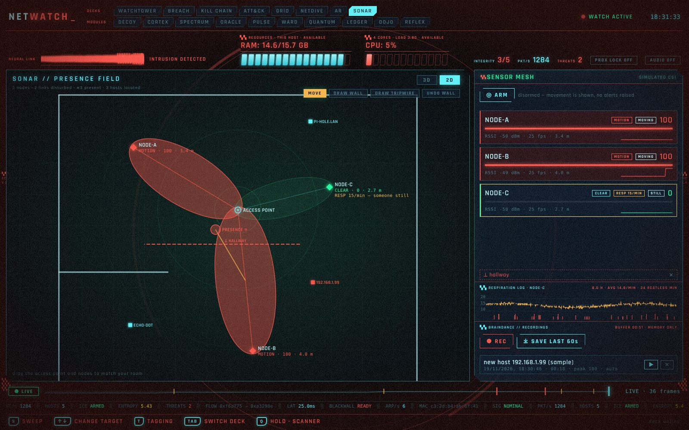

**Arranging the room (2D).**
- **MOVE** — drag the access point and nodes to where they really are. A node
  that reports a measured range stays at that distance; you set the direction.
- **DRAW WALL** — drag to sketch walls. **UNDO WALL** removes the last one.
- **DRAW TRIPWIRE** — drag a line and name it. Remove one from the list on the
  right.

**Reading it.**
- A link's zone turns red when it is disturbed. The marker and trail show the
  estimated position of the movement.
- Each node shows an activity (`still`, `moving`, `walking`, `fall?`) and, on a
  still link, a breathing rate (`RESP n/min`).
- The header line gives a rough head count and how many hosts are located.
- Square markers are network hosts placed from signal strength; red means the
  host is a threat, hollow means fewer than three nodes can hear it.

**ARM.** Disarmed, SONAR only draws. Armed, movement raises an alert, a
tripwire crossing raises a critical alert, a possible fall raises a warning,
and a clip is saved around each movement.

**Respiration log.** Click a node to chart its last 24 hours of breathing rate
and movement.

**Braindance** — recordings of the presence field.


- **REC** starts and stops a clip. **SAVE LAST 60s** keeps what just happened.
- **▶** replays a clip in the room view: play/pause, seek, 0.5–4× speed, **EXIT**.
- While a clip plays, the panel shows the network's host and alert counts from
  that moment, if the console still has them.

---

## Modules

The second row of tabs. Each module is its own deck. All of them work in
`--demo` with sample data, and in demo mode none of them opens a port, writes a
file, probes a host or locks the screen.

### DECOY

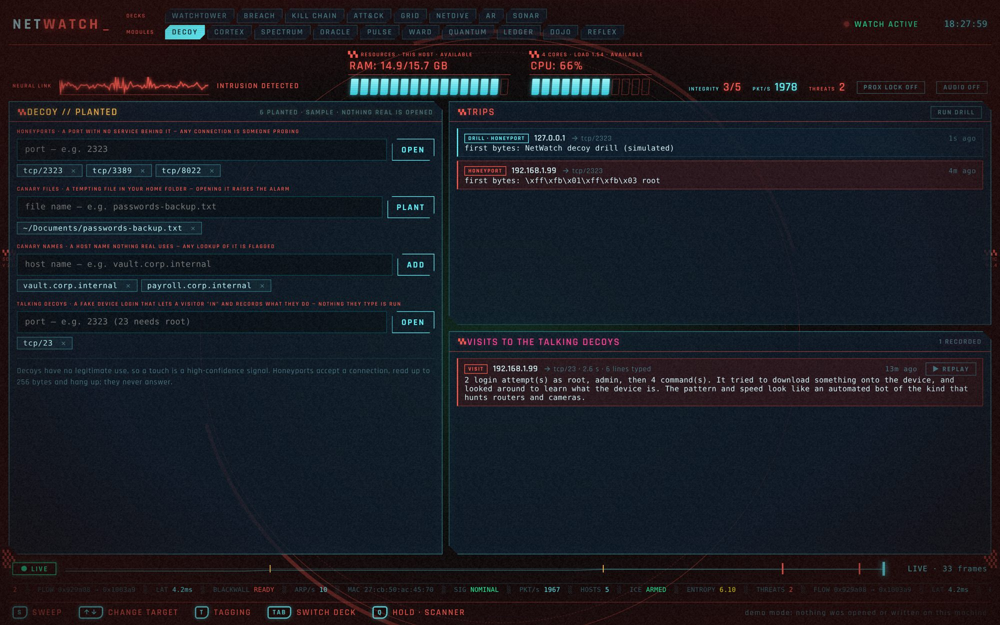

Things that have no legitimate use, so any touch is a strong signal.

- **Honeyports** — type a port and press **OPEN**. NetWatch listens on it with
  no service behind it. A connection raises a critical alert with the caller's
  address and the first bytes it sent; NetWatch reads up to 256 bytes, never
  answers, and hangs up. Ports under 1024 need root. The port is open to your
  whole network, which is the point.
- **Canary files** — type a file name and press **PLANT**. NetWatch writes a
  small file of made-up credentials into `~/Documents` (or your home folder)
  and watches it. Opening it raises the alarm. It will not overwrite an
  existing file, and it only plants inside your home folder. Backup and
  indexing tools open files too, so expect them to trip it. Linux only.
- **Canary names** — add a host name nothing real uses, then leave it where an
  intruder would find it (a note, a config file, a bookmark). Any DNS lookup of
  it that NetWatch can see is flagged with the address that asked.
- **✕** on a chip removes a decoy (and deletes the canary file).
- **RUN DRILL** touches every port and file decoy from this machine. Those
  touches are reported as an informational *drill*, so you can see the alarm
  works without raising a real one.

- **Talking decoys** — type a port and press **OPEN** for a decoy that talks
  back. It imitates a small router's login: the first attempt is refused, the
  second is let "in", and a handful of commands (`id`, `uname -a`, `ls`,
  `cat /proc/cpuinfo`, `wget …`) get canned replies. **Nothing the visitor
  types is run**; it is matched against a fixed table and recorded. Each visit
  appears under *Visits* with a plain summary of what they tried, and
  **▶ REPLAY** plays it back like a terminal recording. Passwords are not
  kept — only how long they were. A visit lasts at most 90 seconds and 16
  commands. With a local model running, commands outside the table get an
  improvised reply.

Decoys are saved and come back after a restart. If a canary file was deleted or
changed while NetWatch was not running, you get a warning at start-up.

### CORTEX


An investigator for alerts. The queue on the left lists recent alerts with a
verdict already worked out; click one to open the case.

- **Chain of reasoning** — each line is one piece of evidence and the weight it
  adds (red, towards a threat) or removes (green): what the alert means, who
  the device is, whether it has a name and a maker, its behaviour score,
  regular call-backs, other alerts from the same source, decoys it touched,
  steps outside its WARD profile, and local programs talking to it.
- **The case for a threat / The sceptic** — the same evidence argued both ways,
  including the ordinary explanation for this kind of alert.
- **Verdict** — *likely threat*, *needs a look* or *likely benign*, from the
  total. The weights are hand-set; treat the verdict as a second opinion.
- **Proposed action** — one of quarantine, trust, verify or watch. Nothing
  happens until you press **APPROVE**; **DISMISS** leaves everything as it is.
  Either way your decision goes into the LEDGER. CORTEX never proposes
  quarantining the gateway or this machine.
- With a local model running (see [the Copilot](#the-copilot-and-local-models)),
  **SUMMARISE WITH THE LOCAL MODEL** asks it for a three-sentence summary. The
  verdict still comes from the rules.

### SPECTRUM

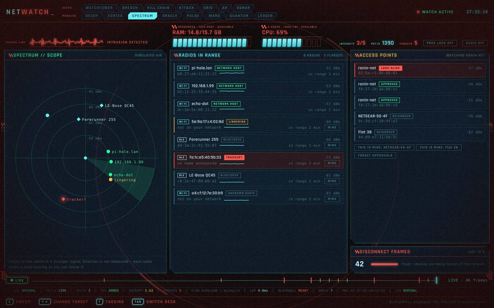

The radios around you, as heard by the SONAR sensor nodes. Without nodes (and
outside demo mode) this deck is empty.

- **Scope** — each radio is a dot; closer to the centre is a stronger signal.
  Direction is not measured: each radio just keeps a fixed bearing. Circles are
  Wi-Fi, diamonds are Bluetooth.
- **Radios in range** — tagged *network host* (it is on your network), *mine*
  (you said so), *bluetooth*, *unknown radio*, *lingering* (a Wi-Fi radio that
  has stayed close for five minutes without joining your network) or
  *tracker?* (a Bluetooth tag advertising the way location trackers do).
  **MINE** stops a radio from ever being flagged.
- **Access points** — press **THIS IS MINE: \<name\>** once while only your own
  access points carry that name. From then on, any other access point
  announcing it is flagged as a **LOOK-ALIKE**. Approve again after adding a
  mesh node.
- **Disconnect frames** — a count over the last ten seconds. A few are normal;
  a burst means devices are being forced off the network.

- **HUNT** (on any radio) — turns the scope into a direction finder. Carry a
  battery-powered sensor node towards where you think the radio is: the big
  number is its signal at the nearest node, **WARMER / COLDER** follows the
  trend, and the ticks speed up as you close in. Signals bounce, so sweep the
  room rather than trusting one reading.

Limits worth knowing: a node hears only the Wi-Fi channel it is on, phones
change their address, and the node firmware does not scan Bluetooth yet, so on
real hardware the Bluetooth rows stay empty for now.

### ORACLE

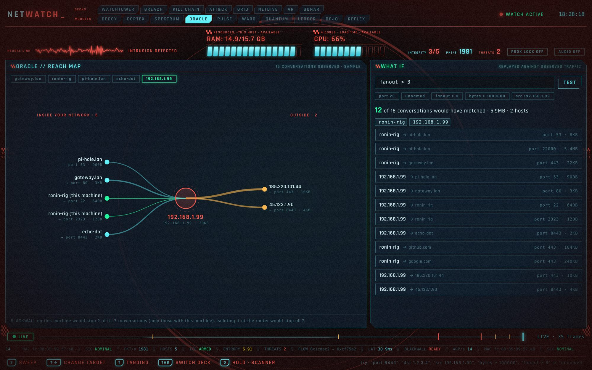

- **Reach map** — pick a host. Everything it has been seen talking to inside
  your network is on the left, everything outside on the right; thicker lines
  carried more data. Green lines are conversations with this machine. The line
  underneath says how many of those conversations a BLACKWALL quarantine would
  really stop — it only blocks traffic to and from *this* machine — and how
  many need the router.
- **What if** — type a rule and press **TEST** to see which observed
  conversations it would have matched. Nothing is blocked.

| Rule | Matches |
|---|---|
| `port 23` | Conversations to that port. |
| `dst 185.220.101.44` · `src 192.168.1.99` | To or from an address. |
| `bytes > 1000000` | Conversations larger than that. |
| `fanout > 3` | Every conversation of a host that talks to more than that many destinations. |
| `unnamed` | Outside conversations where no server name was seen. |

### PULSE

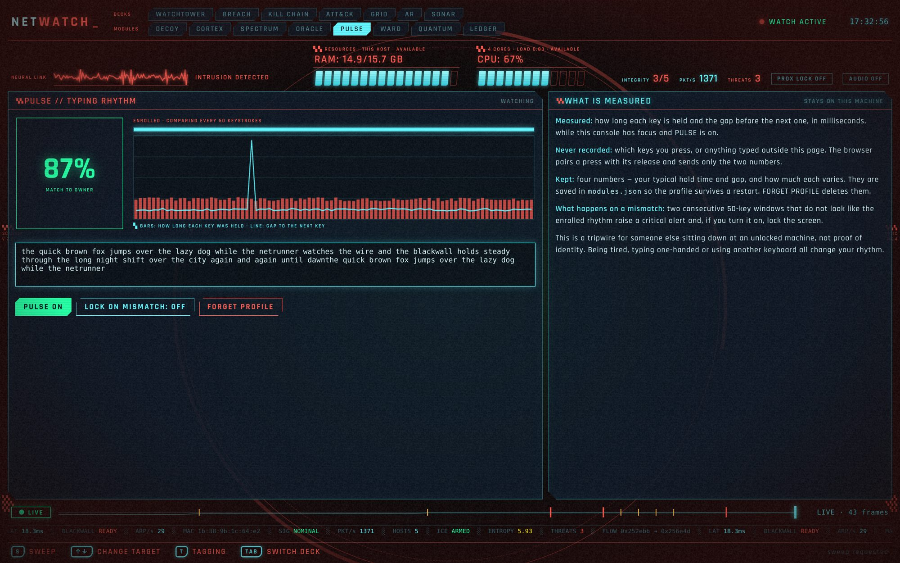

A tripwire for someone else sitting down at your unlocked machine.

1. Press **PULSE OFF** to turn it on, click the text box and type a few
   sentences. After 150 keystrokes you are enrolled.
2. From then on every 50 keystrokes typed anywhere in the console are scored
   against your rhythm. Two windows in a row that do not match raise a critical
   alert, and lock the screen if **LOCK ON MISMATCH** is on.
3. **FORGET PROFILE** deletes the enrolment.

**What is recorded:** how long each key was held and the gap before the next
one, in milliseconds. **Which keys you pressed is never recorded or sent** —
the browser uses the key only to pair a press with its release. Four numbers
are kept (typical hold, typical gap, and how much each varies). PULSE is off
until you turn it on, and only measures while the console has keyboard focus.

It has not been tried on a human typist yet. Being tired, typing one-handed or
using another keyboard changes anyone's rhythm, so expect false alarms.

### WARD

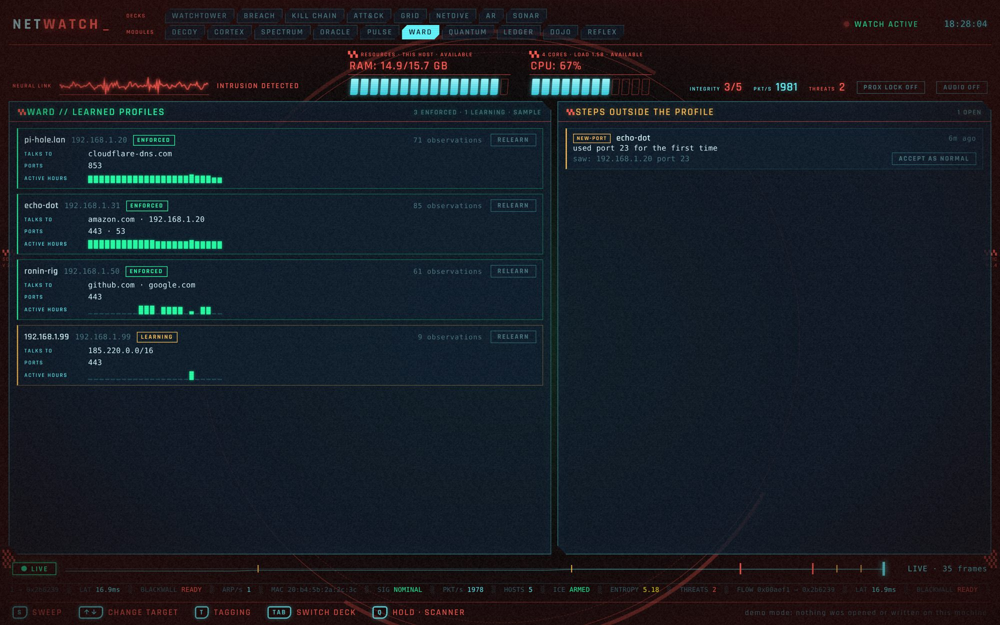

Learns what each device normally does and flags the first step outside it —
useful for gadgets that should be boring.

- A device is **LEARNING** until it has been seen 300 times over at least 24
  hours; after that its profile is **ENFORCED**.
- An enforced device is flagged for a destination it has never used, a new
  port, activity at an hour it is normally silent, a conversation over three
  times its usual size, or a changed TLS fingerprint (new firmware, or
  different software at that address).
- **ACCEPT AS NORMAL** adds what was seen to the profile. **RELEARN** throws
  the profile away and starts again — do that after you reconfigure a device.

WARD needs live capture, and can only learn from traffic that reaches this
machine.

### QUANTUM

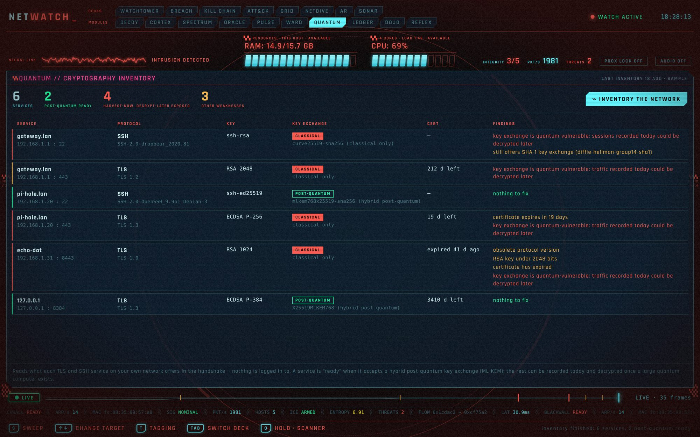

Press **INVENTORY THE NETWORK**. NetWatch opens a TLS handshake with every
known host on ports 443, 8443, 993 and 8883, and reads the SSH banner and
algorithm list on port 22. It does not log in to anything, and it only talks to
private addresses.

For each service it shows the protocol version, the key type and size, days
until the certificate expires, and whether the key exchange is **POST-QUANTUM**
(the server accepts a hybrid ML-KEM exchange) or **CLASSICAL**. A classical
exchange can be recorded today and decrypted once a large quantum computer
exists; for most home traffic that matters less than the other findings it
lists — expired certificates, RSA keys under 2048 bits, TLS 1.0, SHA-1.

### LEDGER

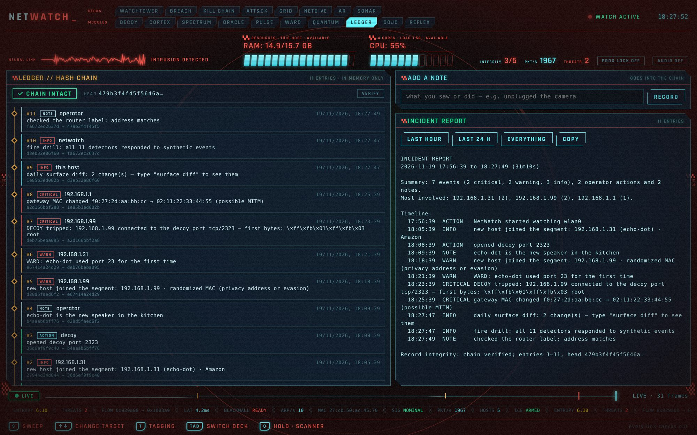

A record that shows when it has been altered. Every alert, every action you
take (trust, quarantine, decoys, approvals) and any note you add becomes an
entry carrying the hash of the entry before it.

- **CHAIN INTACT / CHAIN BROKEN AT #n** — the result of checking every link.
  **VERIFY** also re-reads the file from disk, which is what catches an edit
  made behind NetWatch's back.
- **HEAD** — the hash of the newest entry. Someone who can rewrite the whole
  file can rebuild a consistent chain, so if you need to rule that out, copy
  the head somewhere else from time to time.
- **Add a note** — record what you saw or did.
- **Incident report** — **LAST HOUR**, **LAST 24 H** or **EVERYTHING** writes a
  plain-text summary and timeline from the chain. **COPY** puts it on the
  clipboard.

### DOJO

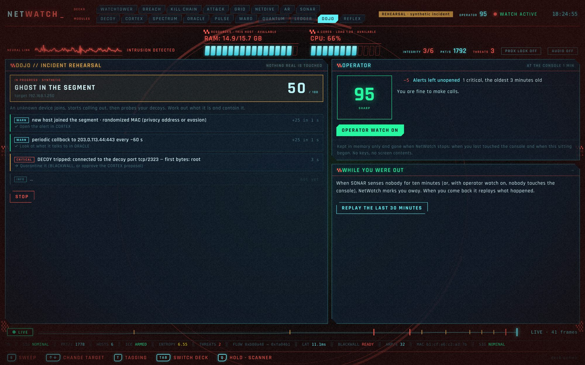

**Incident rehearsal.** Pick a scenario and press **START**. NetWatch plays a
scripted incident into the live console: alerts arrive over about a minute,
each marked `[REHEARSAL]`, and you respond with the real controls — open the
alert in CORTEX, look at the host in ORACLE, quarantine it, write a LEDGER
note. Each expected response earns points, more if you are quick; the wrong
move (quarantining the gateway in *Mirror at the gate*) costs fifteen.

Nothing real is touched. The intruder is a made-up host (`REHEARSAL-GHOST`, at
`.250` of your subnet) that disappears when the drill ends, and a quarantine
aimed at it is simulated — the firewall is not called. The drill's alerts and
your score are written to the LEDGER, labelled.

**Operator.** **OPERATOR WATCH** is off until you turn it on. When on, the
console estimates how sharp you are (100 is fresh) from how long you have been
at it without a fifteen-minute break, the hour, how far your typing has drifted
from your PULSE profile (if you enrolled one), and critical alerts you have not
opened. The number also appears in the top bar. At *spent*, CORTEX makes you
press APPROVE twice before a quarantine. It keeps two timestamps in memory and
stores nothing.

**While you were out.** NetWatch marks you away when SONAR has sensed nobody
for ten minutes (or, with operator watch on, nobody has touched the console).
When you come back a panel replays the gap: counts, who joined and left, and a
time-lapse through the scrubber's history with each alert appearing at its
moment. **REPLAY THE LAST 30 MINUTES** shows one on demand. `Esc` closes it.

### REFLEX

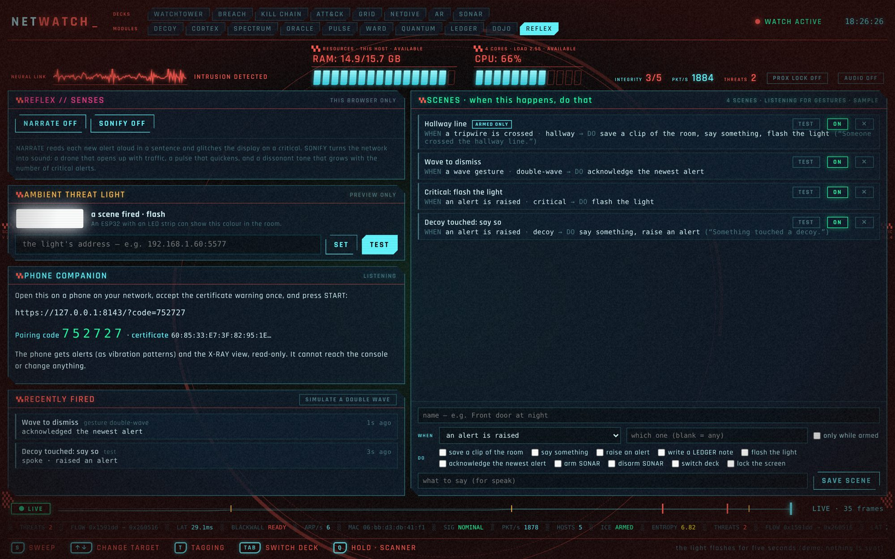

- **NARRATE** — each new alert is spoken as one sentence, and a critical
  glitches the display. **SONIFY** — the network as a continuous sound: a drone
  that brightens with traffic, a pulse that quickens with it, a dissonant tone
  that grows with unopened critical alerts, and a bell for each alert. Both
  are per-browser and off by default.
- **Scenes** — "when this happens, do that". Give a scene a name, choose a
  trigger (a tripwire is crossed, movement on a link, an alert is raised,
  everyone leaves, someone returns, a wave gesture), optionally say which one
  (the wire's name, a node, an alert kind such as `decoy` or a severity such as
  `critical`), and tick the actions: save a clip of the room, say something,
  raise an alert, write a LEDGER note, flash the light, acknowledge the newest
  alert, arm or disarm SONAR, switch deck, lock the screen. **TEST** runs a
  scene now; **ON/OFF** disables it; a scene will not fire again within five
  seconds (or its own cooldown). Scenes are saved.
- **Gestures** — while any scene uses the gesture trigger, NetWatch listens for
  two or three short waves through a sensor link followed by about three
  seconds of stillness (`double-wave`, `triple-wave`). Walking through does not
  count. **SIMULATE A DOUBLE WAVE** tests your gesture scenes without hardware.
- **Ambient threat light** — the swatch shows the colour NetWatch would send:
  green when quiet, amber for unopened warnings, breathing red for unopened
  critical alerts, flashing red for one that just arrived, blue while SONAR is
  armed. Enter the address of a light (see [hardware](#esp32-s3-hardware)) and
  press **SET**; **TEST** flashes it. Only private addresses are accepted.
- **Phone companion** — see [below](#phone-companion).

### Phone companion

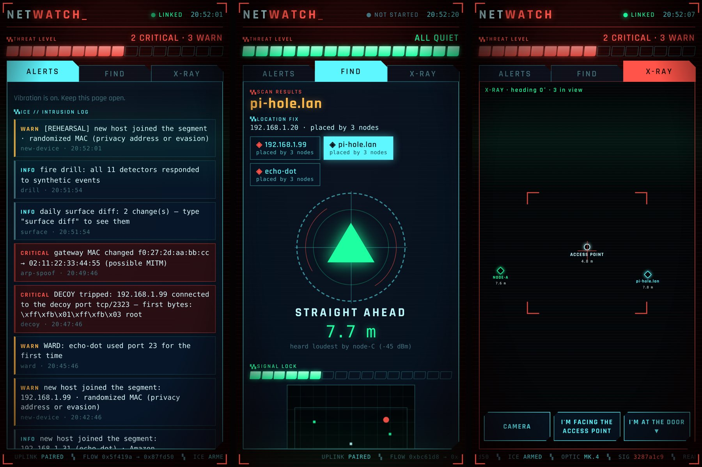

A read-only page for your phone. Start NetWatch with a second address:

```bash
./bin/netwatch gui --companion 0.0.0.0:7443
```

The REFLEX deck then shows a link and a six-digit **pairing code**. Open the
link on a phone on the same network. The certificate is self-signed, so the
browser warns once; the deck shows the certificate's first bytes if you want to
compare. Press **START**.

- **ALERTS** — the latest alerts, and a vibration pattern per kind (a decoy
  trip, a gateway change, a new device and a tripwire each feel different).
  iPhones do not allow web pages to vibrate; there the page flashes and beeps.
- **X-RAY** — SONAR's view drawn over the camera: tap **CAMERA**, say roughly
  where you are, face the access point and tap **I'M FACING THE ACCESS POINT**
  so the compass lines up with your room map. Without a compass, drag to look
  around.

The companion listener serves that page, the alert stream and the SONAR view,
and nothing else: the console's controls are not reachable through it, and
every data request needs the pairing code (ten wrong guesses lock it for a
minute). The code changes each time NetWatch starts.

---

## Commands and voice

The Copilot box is also a command line. Anything it does not recognise is
passed to the Copilot as a question. **VOICE** (or `V`) accepts the same
commands by speech and reads the reply aloud.

| Say or type | Effect |
|---|---|
| `sweep` | Sweep the network now. |
| `select gateway` · `select pi-hole` · `select 99` | Lock on to a host by role, name or last octet. |
| `trust` · `untrust` (optionally a host) | Mark a host trusted or unverified. |
| `quarantine <host>` then `confirm` | Block a host at the firewall. `cancel` aborts. |
| `release <host>` | Lift a quarantine. |
| `switch to sonar` (or any deck) | Change deck. |
| `rewind 10 minutes` · `go live` | Move the time scrubber. |
| `arm sonar` · `disarm sonar` | Arm or disarm SONAR. |
| `record` · `stop recording` · `save clip` | Braindance recording. |
| `play last clip` · `exit replay` | Braindance replay. |
| `how many people` | SONAR head count. |
| `sleep report` | Summary of the respiration log. |
| `set key <host>` · `clear key` | Presence key. |
| `what changed` | Daily surface diff. |
| `fire drill` | Run the detector fire drill. |
| `usb` | List USB devices. |
| `lock` | Lock the screen. |
| `proximity lock on` · `off` | Ultrasonic proximity lock. |
| `audio on` · `audio off` | Spatial audio alerts. |
| `investigate` · `investigate <host>` then `approve` or `dismiss` | Open the newest case (or a host's) in CORTEX and decide on its proposal. |
| `open honeyport 2323` · `decoy drill` | Open a decoy port; run the decoy drill. |
| `radios` | What SPECTRUM hears, and which radios are flagged. |
| `reach <host>` · `what if port 23` | ORACLE: a host's reach; test a rule. |
| `pulse on` · `pulse off` | Typing-rhythm watch. |
| `quantum scan` | Start the cryptography inventory. |
| `verify ledger` · `note: <text>` · `report` · `report last hour` | LEDGER: check the chain, add a note, write the incident report. |
| `rehearsal` · `rehearsal mirror` · `stop rehearsal` | Start or stop an incident rehearsal. |
| `what did i miss` · `recap 60 minutes` | Replay what happened while you were out. |
| `scanner` | Open scanner mode (the same as holding `Q`). |
| `ack` · `ack all` | Acknowledge the newest alert, or all of them. |
| `operator watch on` · `how am i` | The fatigue meter. |
| `narrate on` · `sonify on` (and `off`) | Spoken commentary; the soundscape. |
| `hunt <radio>` · `hunt stranger` · `stop hunt` | HUNT mode in SPECTRUM. |
| `xray on` · `xray off` | X-RAY in the AR deck. |
| `scenes` · `fire scene <name>` · `light test` | REFLEX scenes and the threat light. |
| `open talking decoy 2323` | Open a talking decoy. |
| `companion` | Read out the phone companion's link and pairing code. |
| `add a node` · `listen for nodes` | Open the board flasher; start accepting sensor nodes. |

Voice uses the browser's speech recognition. In Chrome that sends audio to
Google; type the commands if you want everything to stay on your machine.

---

## The Copilot and local models

The Copilot answers questions about the current state of your network. It uses
a model served by [Ollama](https://ollama.com) on your own machine when one is
running, and built-in rules otherwise. There is no API key or token cost, and
nothing leaves the host.

```bash
ollama pull llama3.2
```

Start the console afterwards; the Copilot panel shows which backend is
answering. If your machine is short on memory, try a smaller model such as
`llama3.2:1b` and set `NETWATCH_LLM_MODEL`. You can also run Ollama on another
machine on your LAN and point `NETWATCH_LLM_URL` at it.

Names and text observed on the network are passed to the model as data and it
is told not to follow instructions found in them.

---

## Host features

These watch the machine NetWatch runs on.

- **Spatial audio** — **AUDIO ON** plays each new alert from a direction. Use
  headphones.
- **Proximity lock** — **PROX LOCK** plays a quiet 19 kHz tone and listens for
  movement near the laptop. After a minute of none it warns for ten seconds,
  then locks the screen. It needs the microphone. It may not work on speakers
  that cannot reach 19 kHz, and someone sitting perfectly still looks the same
  as an empty chair.
- **USB watch** — a newly attached device raises an alert; keyboards are called
  out. If NetWatch can read `/dev/input`, a keyboard that types faster than a
  person raises a critical alert.
- **Daily surface diff** — compares listening ports, start-up entries, hosts
  and USB devices with the previous day. Runs daily; ask with `what changed`.
- **Detector fire drill** — stages harmless synthetic events against each
  detector at start-up and daily, and raises a critical alert if one stays
  silent. Ask with `fire drill`.
- **Process lineage** — which program owns each connection. Shown on GRID and
  in the Kill Chain and ATT&CK ops consoles.

---

## ESP32-S3 hardware

The node firmware is in `firmware/esp32s3-csi`. It is built automatically on
GitHub and the image is embedded in the `netwatch` binary, so you do not need
Espressif's toolchain. **It compiles, but it has not yet run on a board**:
expect to find problems the first time, and tell me what the board logs.

### Flash a board from the console

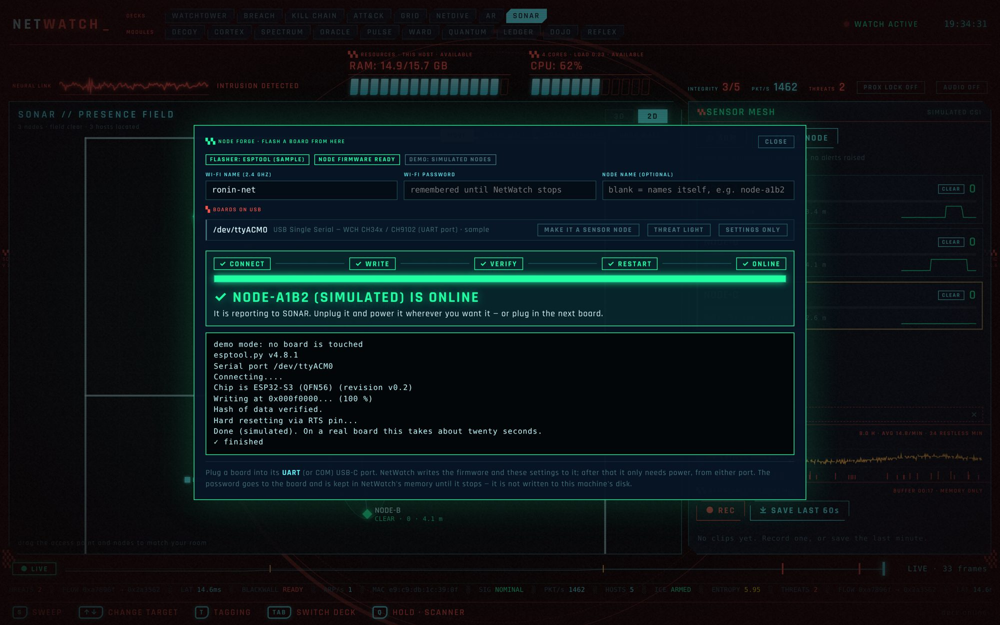

You need `esptool` once (`pipx install esptool`, or `sudo apt install esptool`)
and your user in the `dialout` group (`sudo usermod -aG dialout $USER`, then
log out and in).

1. Plug the board into your laptop by its **UART** (or **COM**) USB-C port. On
   boards with two ports, the other one is the chip's native USB; it usually
   works too, but the UART port is the reliable one for flashing.
2. In **SONAR**, press **＋ ADD A NODE**. The board appears with its port. (An
   alert also tells you when a board is plugged in.)
3. Type your Wi-Fi name and password (2.4 GHz only) and press **MAKE IT A
   SENSOR NODE**. It takes about twenty seconds; the log shows esptool's
   progress. If it cannot connect, hold the board's **BOOT** button, tap
   **RESET**, release BOOT and try again.
4. Unplug it and power it anywhere in range — any USB charger or power bank, on
   either port. It joins your Wi-Fi and shows up in SONAR within about ten
   seconds, named after its hardware address (`node-a1b2`) unless you gave it a
   name.
5. Plug in the next board and press the button again. The Wi-Fi details are
   remembered until NetWatch stops.

Flashing a board this way also makes NetWatch start listening for nodes (UDP
port 5566 on your network) and remember to do so on later starts, so you no
longer need `--sonar-udp`. Nodes also ask the network where NetWatch is every
fifteen seconds, so if your laptop's address changes they find it again without
reflashing. **SETTINGS ONLY** rewrites just the Wi-Fi details on a board that
already has the firmware. **THREAT LIGHT** flashes the LED-light firmware
instead.

The Wi-Fi password is written to the board (in plain form, in its flash) and
kept in NetWatch's memory until it stops. It is never written to this
machine's disk: the file handed to esptool lives in a private temporary folder
that is deleted as soon as the flash ends.

### Or flash by hand

1. Install ESP-IDF v5 using Espressif's "Get Started" guide for Linux, and
   load it into your shell (`. ~/esp/esp-idf/export.sh`).
2. In `main/csi_node.c`, set your Wi-Fi name and password and the IP address of
   the machine running NetWatch.
3. Build once, then flash each board:

   ```bash
   cd firmware/esp32s3-csi && idf.py set-target esp32s3
   ```

   ```bash
   idf.py build
   ```

   ```bash
   idf.py -p /dev/ttyACM0 flash monitor
   ```

4. Start the console listening on your LAN:

   ```bash
   ./bin/netwatch gui --sonar-udp 0.0.0.0:5566
   ```

Either way, open SONAR, keep the room still for about five seconds while the
nodes calibrate, then arrange them in the 2D view.

Things to know:

- The ESP32-S3 only joins 2.4 GHz networks.
- If you run a firewall, allow incoming UDP on port 5566.
- Each node senses the line between itself and the router, so place nodes where
  those lines cross the spaces you care about. Three or four around a room give
  the position estimates something to work with.
- Ranging only works if your router supports 802.11mc (FTM). The firmware logs
  whether it does.
- If the laptop's IP address changes, nodes flashed from the console find it
  again within about fifteen seconds. A DHCP reservation is still the surest
  way.

Each sensor frame is one JSON datagram:

```json
{"node":"node-A","rssi":-51,"amp":[12.0,13.4],"dist_cm":412}
```

and once a second, the devices the node overheard:

```json
{"node":"node-A","seen":[{"mac":"aa:bb:cc:dd:ee:ff","rssi":-52}]}
```

For SPECTRUM the node also reports the access points it hears and how many
disconnect frames went past in the last second:

```json
{"node":"node-A","deauth":0,"aps":[{"ssid":"home","bssid":"aa:bb:cc:dd:ee:f0","rssi":-41}]}
```

The console also accepts Bluetooth advertisements in the same datagram, as
`"ble":[{"addr":"…","rssi":-70,"name":"…","company":76,"type":18}]`, but the
firmware here does not scan Bluetooth, so nothing sends them yet.

### The threat light

`firmware/esp32-light` is a second, small project: an ESP32 with a WS2812 LED
strip that listens on UDP port 5577 and shows the colour NetWatch sends. Edit
the Wi-Fi details, data pin and LED count in `main/light.c`, flash it, and put
the address it logs into the REFLEX deck — or flash it from **＋ ADD A NODE**
with the **THREAT LIGHT** button, which also writes your Wi-Fi details. Like
the node firmware it compiles but has not run on a board yet. Each datagram is one line:

```json
{"r":255,"g":30,"b":20,"pulse":"breathe","why":"2 critical alert(s) unopened"}
```

---

## Files and privacy

Everything NetWatch stores is under the data directory
(`~/.local/share/netwatch` unless you pass `--data-dir`):

| Path | Contents |
|---|---|
| `braindance/bd-*.json` | Braindance clips. |
| `room.json` | Node positions, walls and tripwires. |
| `sleep.json` | The respiration log. |
| `surface/surface-YYYY-MM-DD.json` | Daily surface snapshots. |
| `ledger.jsonl` | The LEDGER: one hash-chained entry per line for every alert, action and note. |
| `firmware/*.bin` | Optional: a firmware image placed here (`sonar-node.bin`, `threat-light.bin`) is flashed instead of the one built into NetWatch. |
| `modules.json` | Whether to listen for sensor nodes at start-up, planted decoys and talking-decoy ports, WARD's learned profiles, the PULSE typing profile (four numbers) and whether it may lock the screen, approved access points, radios you marked as yours, your scenes, and the threat light's address. |

Canary files are the one thing NetWatch writes outside that directory: they go
where you plant them, inside your home folder, and are deleted when you remove
the decoy.

Nothing is sent off the machine. Two features involve other services if you
turn them on: voice in Chrome (speech goes to Google) and a Copilot pointed at
an Ollama host that is not your own machine.

Braindance clips and the respiration log record when people moved and breathed
in your space. Keep them private, and tell the people you live or work with
that SONAR is running.

PULSE stores a description of how you type — typical key hold time and gap, and
how much each varies — and never which keys. It is off until you turn it on.
SPECTRUM's list of nearby radios is kept in memory only; just the radios you
mark as yours and the access points you approve are saved. The ledger holds
every alert, so it includes the addresses and names of devices on your network.

Operator watch keeps two timestamps in memory and stores nothing. Talking
decoys keep what a visitor typed (in memory, most recent 60 visits) but not
their passwords. Commentary and the soundscape use the browser's own speech
and audio; nothing is sent anywhere. The phone companion is off unless you
start NetWatch with `--companion`; when on, a phone that knows the pairing code
can read your alerts and the SONAR view over your network.

---

## Troubleshooting

| Symptom | Likely cause |
|---|---|
| "permission denied opening raw socket" | Run the `setcap` command above, or use `--demo`. |
| Quarantine fails | The binary lacks `cap_net_admin`, or `nft` is not installed. |
| SONAR shows "no nodes reporting" | The console was not started with `--sonar-udp`, a firewall is blocking UDP 5566, or the boards are pointed at the wrong IP. |
| 3D button is disabled | The browser is not providing WebGL; 2D still works. |
| Copilot says "built-in rules" | Ollama is not running, or has no model installed. |
| VOICE button is disabled | The browser has no speech recognition; type commands instead. |
| Trust or quarantine is refused | A presence key is set and that device is off the network. |
| Process names are missing | The connection belongs to another user; run NetWatch as root to see it. |
| A honeyport will not open | Something already uses that port, or it is under 1024 and NetWatch is not root. |
| A canary file keeps tripping | A backup, search indexer or antivirus is opening it; plant it somewhere they skip, or remove it. |
| SPECTRUM is empty | No sensor nodes are reporting, or their firmware predates access-point reporting. |
| WARD stays on LEARNING | It needs 300 observations *and* 24 hours per device, and live capture. |
| PULSE flags you | Your rhythm changed (another keyboard, one hand). FORGET PROFILE and enrol again. |
| ADD A NODE shows no board | The cable carries power only, the board is on a port NetWatch does not recognise, or you are not in the `dialout` group. |
| Flashing fails to connect | Hold BOOT, tap RESET, release BOOT, and try again; or move the cable to the UART port. |
| A flashed node never appears | Wrong Wi-Fi password or a 5 GHz-only network; a firewall blocking UDP 5566; plug it back in and read its log with `esptool`'s monitor or `screen /dev/ttyACM0 115200`. |
| NETDIVE is blank | The browser is not providing WebGL. |
| The phone cannot open the companion | It is not on the same network, a firewall blocks the port, or the certificate warning was not accepted. |
| The companion says NO LINK | The pairing code is wrong or NetWatch restarted (the code changes each start). |
| A scene does not fire | It is OFF, in its cooldown, marked *only while armed*, or its "which one" does not match. |
| A gesture is never recognised | It needs two or three short waves with a pause between them and then stillness; this is untested on real sensors. |
| An action returns "cross-site request refused" | The request did not come from the console's own page. Open the console at the address it was started on. |
